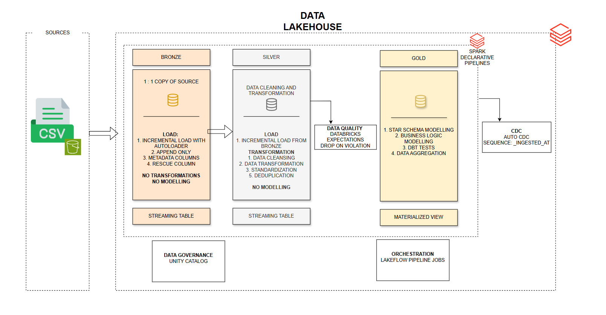
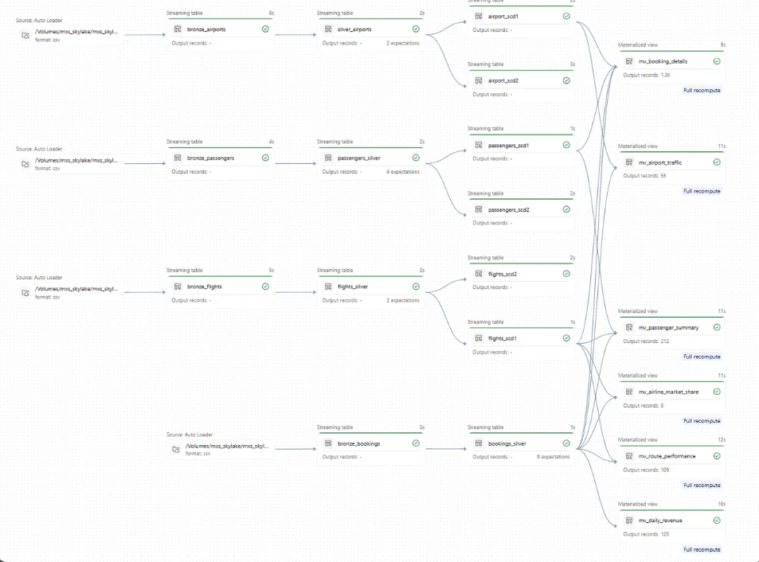
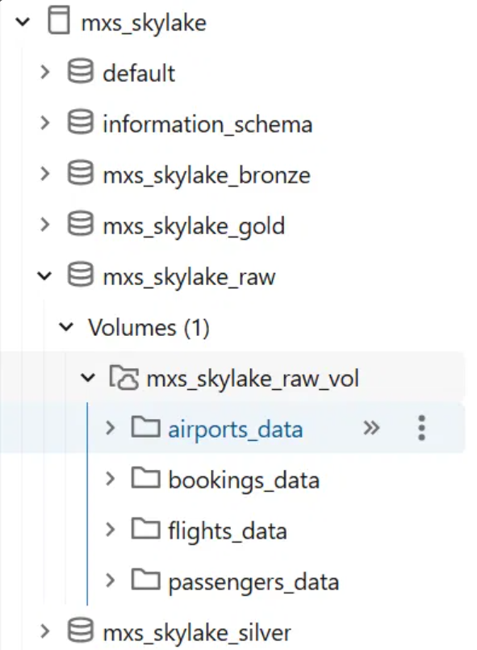

# MXS SkyLake ✈️
### Building an Airline Data Platform with Databricks Lakeflow Declarative Pipelines


---

## 1. The Story Behind the Project

I've always had a thing for airplanes.

Growing up, I would occasionally joke with my friends about wanting to become a soldier, specifically an Air Force officer. The idea of flying aircraft, travelling and being part of the aviation world sounded exciting to me. I never really pursued that particular career path, but the fascination with airplanes never quite disappeared.

Fast-forward to my journey into technology.

As an Information Systems student in Ghana, I've developed a growing interest in data engineering. My ambition is to become a data engineer, pursue a master's degree in Germany, and eventually build a career in the European technology industry.

I'm particularly interested in understanding how data is collected, processed, transformed and made available for analytical consumption.

While exploring datasets on GitHub, I stumbled upon an airline-related dataset containing information about airports, passengers, flights and bookings. Given my longstanding interest in aviation, it immediately caught my attention.

I saw an opportunity.

Rather than working with another generic dataset, I decided to use this one to build something that would allow me to practise the concepts I've been learning about data engineering.

That was how **MXS SkyLake** came about.

The objective was not simply to load some CSV files into Databricks. I wanted to understand how an actual data platform could be structured, how ingestion and transformation responsibilities could be separated, how data quality could be enforced, and how historical changes could be managed before making data available for business analytics.

I chose Databricks and its Lakeflow Declarative Pipelines capabilities to bring these ideas together.

This project is one of my practical attempts at bridging the gap between learning data engineering concepts and implementing them in a cloud data platform.

And perhaps, in a small way, it brings together two things I have always been interested in: airplanes and technology.

**Schritt für Schritt — step by step.**

---

## 2. Project Overview

MXS SkyLake is an airline data platform built using Databricks Free Edition and Lakeflow Declarative Pipelines.

The platform ingests four datasets:

- Airports
- Passengers
- Flights
- Bookings

The data is initially supplied as CSV files and ingested into Databricks using Auto Loader.

The platform follows the Medallion Architecture, separating data processing into three layers:

| Layer | Responsibility |
|---|---|
| Bronze | Raw data ingestion and preservation |
| Silver | Data cleaning, standardisation, deduplication and quality enforcement |
| Gold | Change data capture, dimensional modelling and business-oriented analytical views |

The project also explores Slowly Changing Dimensions (SCD), particularly Types 1 and 2, to demonstrate how changes to dimension records can be handled differently depending on analytical requirements.

The final output is a collection of Gold-layer materialized views designed to support airline business analytics.

### Project objectives

The primary objectives were to:

1. Implement incremental ingestion using Databricks Auto Loader.
2. Understand and implement Lakeflow Declarative Pipelines.
3. Apply Medallion Architecture principles.
4. Introduce data quality expectations into transformation pipelines.
5. Implement CDC using Lakeflow's Auto CDC capabilities.
6. Understand and implement SCD Type 1 and Type 2.
7. Build analytical datasets using dimensional modelling principles.
8. Use Unity Catalog to organise and govern data assets.
9. Orchestrate data processing through Lakeflow Jobs.

---

## 3. Architecture

The project follows a Medallion Architecture implemented using Databricks Lakeflow Declarative Pipelines.

### High-level data flow



The transformation graph is managed by Lakeflow Declarative Pipelines, while Unity Catalog provides the organisational and governance layer.

### Pipeline dependencies

The pipeline is organised around the four source entities.

Each source follows an independent ingestion and cleaning path:



---

## 4. Technology Stack

| Technology | Purpose |
|---|---|
| Databricks Free Edition | Cloud data engineering environment |
| PySpark | Data processing and transformations |
| Python | Pipeline implementation and reusable logic |
| Spark SQL | Analytical transformations and materialized views |
| Lakeflow Declarative Pipelines | Declarative pipeline development and execution |
| Databricks Auto Loader | Incremental file ingestion |
| Delta Lake | Reliable table storage and transaction management |
| Unity Catalog | Data organisation, access management and governance |
| Lakeflow Jobs | Pipeline orchestration |

**Note:** This project was developed entirely within Databricks Free Edition. AWS, Amazon S3 and other external cloud infrastructure were not part of the implemented solution.

---

## 5. Data Organisation and Repository Structure

The project uses a separation between exploratory notebooks and reusable transformation code.


### Explorations

The exploration directory contains notebooks used to investigate the data and develop transformation logic before incorporating it into the main pipeline.

### Transformations

The transformations directory contains the reusable Python and SQL implementations responsible for processing the datasets.

The separation allows exploratory work to remain independent of the main pipeline implementation.

### Unity Catalog organisation

The project uses a dedicated catalog named `mxs_skylake`, with separate schemas for the different processing layers.

The organisation includes:



The raw schema contains the source files stored in Unity Catalog Volumes, while the other schemas organise the corresponding Delta tables.

---

## 6. The Bronze Layer: Ingestion

The Bronze layer is responsible for bringing source data into the lakehouse.

I used Databricks Auto Loader to ingest the CSV files incrementally.

Instead of treating ingestion as a process of repeatedly reading entire datasets, Auto Loader provides a mechanism for discovering and processing newly arriving files.

The Bronze layer follows a relatively simple philosophy:

**Preserve the source data before applying business transformations.**

Its responsibilities include:

- Incremental ingestion using Auto Loader.
- Maintaining a close representation of the original source.
- Appending incoming records.
- Capturing ingestion metadata.
- Supporting rescued data where applicable.
- Avoiding business-level transformations and modelling.

The four Bronze streaming tables are:

| Table | Source |
|---|---|
| `bronze_airports` | Airports CSV |
| `bronze_passengers` | Passengers CSV |
| `bronze_flights` | Flights CSV |
| `bronze_bookings` | Bookings CSV |

No dimensional modelling or business aggregations are performed at this stage.

---

## 7. The Silver Layer: Cleaning and Standardisation

The Silver layer transforms the raw datasets into cleaner and more consistent representations.

This is where I implemented the data preparation logic required before downstream processing.

The main responsibilities include:

1. Data cleansing.
2. Data type transformations.
3. Standardisation.
4. Deduplication.
5. Data quality validation.

The resulting tables are:

- `silver_airports`
- `passengers_silver`
- `flights_silver`
- `bookings_silver`

### Data quality expectations

I incorporated Databricks data quality expectations into the Silver transformations.

These expectations help validate records against defined business and structural rules.

The pipeline includes:

| Silver table | Configured expectations |
|---|---:|
| Airports | 2 |
| Passengers | 4 |
| Flights | 2 |
| Bookings | 6 |

The expectations are configured according to the validation requirements of each dataset.

Depending on the rule, records can be validated, retained with violations or dropped when they fail a critical condition.

An important lesson from this implementation was that data quality rules must be tested against the actual values in the source data rather than assumptions about how those values should be represented.

More on this in the engineering challenges section.

---

## 8. Change Data Capture and Slowly Changing Dimensions

One of the more interesting architectural decisions in this project was determining how to handle changes to dimension records.

Rather than stopping at the Silver layer, I decided to preserve change information until the Gold layer, where different historical processing requirements could be addressed.

I explored Databricks Lakeflow Auto CDC to implement this functionality.

### Why Auto CDC?

The source datasets did not provide a reliable business sequence column that could be used to determine the order of changes.

I therefore used `_ingested_at` as the sequencing column.

This allowed incoming records to be processed according to their ingestion timestamps.

It is important to recognise the trade-off here: `_ingested_at` represents ingestion order, not necessarily the actual order in which business events occurred.

For this project's available data, it was a practical choice.

I selected Auto CDC rather than Auto CDC from Snapshot because the available data and ingestion pattern were better suited to processing incoming change records than comparing successive full snapshots.

### SCD Type 1

SCD Type 1 maintains the latest version of a dimension record.

When an existing record changes, its previous attribute values are overwritten.

This is useful when analytical consumers are primarily interested in the current state of an entity.

Examples include:

- Current passenger attributes.
- Current flight information.
- Current airport information.

### SCD Type 2

SCD Type 2 preserves historical versions of dimension records.

Instead of overwriting previous values, it maintains multiple versions of a record, allowing historical changes to be analysed.

This is useful when consumers need to understand how an entity's attributes have changed over time.

### Why implement both?

I deliberately implemented both approaches to support different analytical requirements.

| Requirement | SCD Type 1 | SCD Type 2 |
|---|---|---|
| Current-state reporting | Yes | Yes, using current records |
| Historical attribute tracking | No | Yes |
| Previous values retained | No | Yes |
| Simpler analytical joins | Yes | Requires temporal logic |
| Point-in-time analysis | No | Yes |

The Gold layer therefore exposes both versions of the dimensions.

This gives downstream consumers the flexibility to work with current-state dimensions or historical dimensions, depending on their requirements.

---

## 9. The Gold Layer: Business Analytics

The Gold layer is where the transformed data becomes useful for business-oriented analytical consumption.

Rather than simply exposing cleaned datasets, I wanted to create datasets that could answer meaningful questions about airline operations and commercial performance.

The Gold layer contains the dimensional processing outputs and six materialized views.

### 9.1 Booking Details

**Table:** `mv_booking_details`

This view enriches individual bookings with information from the passenger, flight and airport dimensions.

It includes:

- Booking information.
- Passenger name, nationality and gender.
- Airline and route information.
- Flight dates.
- Airport details.
- Booking amount and booking date.

The view uses the SCD Type 1 dimensions to provide current-state descriptive attributes.

### 9.2 Route Performance

**Table:** `mv_route_performance`

This view measures booking activity and revenue across airline routes.

Key metrics include:

- Total bookings.
- Total revenue.
- Average booking amount.
- First booking date.
- Last booking date.

It supports comparisons between airlines and their operating routes.

### 9.3 Airport Traffic

**Table:** `mv_airport_traffic`

This view summarises booking activity associated with individual airports.

It provides:

- Total bookings.
- Total revenue.
- Average booking amount.

The results are grouped by airport, city and country.

### 9.4 Passenger Summary

**Table:** `mv_passenger_summary`

This is a passenger-level analytical view, sometimes referred to as a Passenger 360 view.

It summarises passenger booking and spending behaviour.

Metrics include:

- Total bookings.
- Total spending.
- Average booking amount.
- Distinct flights.
- Distinct destinations.
- First and last booking dates.

### 9.5 Daily Revenue

**Table:** `mv_daily_revenue`

This view provides a daily breakdown of booking activity and revenue.

It calculates:

- Total bookings per day.
- Total revenue per day.
- Average booking amount.

It can support revenue trend analysis over time.

### 9.6 Airline Market Share

**Table:** `mv_airline_market_share`

This view compares airlines based on their contribution to total booking volume and revenue.

It calculates:

- Total bookings per airline.
- Total revenue per airline.
- Revenue market share percentage.
- Booking market share percentage.

This makes it possible to compare airline performance using both revenue and booking volume.

### Materialized view refresh

The materialized views were configured with an hourly refresh schedule.

They provide precomputed analytical outputs rather than requiring every downstream consumer to repeatedly execute the underlying aggregation queries.

The SQL implementations can be found in:

`transformations/gold/aggregate.sql`

**Platform requirement:** Databricks SQL materialized view creation and refresh require a supported Pro or Serverless SQL warehouse. Availability depends on the workspace edition and supported compute configuration.

---

## 10. Orchestration

The project uses Lakeflow Jobs to orchestrate pipeline execution.

Lakeflow Declarative Pipelines define the data transformation dependencies, while Lakeflow Jobs provide the orchestration mechanism for running the pipeline.

This separation is important.

The pipeline is responsible for defining what transformations need to happen and their dependencies.

The orchestration layer is responsible for managing execution.

The intended flow is:

```text
Source Files
     |
     v
Bronze Ingestion
     |
     v
Silver Transformations
     |
     v
CDC / SCD Processing
     |
     v
Gold Processing
     |
     v
Business Materialized Views
```

---

## 11. Engineering Challenges and Decisions

Building this project was not entirely straightforward. Some of the most valuable lessons came from debugging issues and reconsidering architectural decisions.

Here are some of the challenges I encountered.

### 11.1 Incorrect Data Quality Expectation

**The problem**

While implementing data quality expectations for the passenger dataset, I introduced an incorrect validation rule for gender.

My original expectation was:

```python
"valid_gender": "gender IN ('male', 'female', 'Others')"
```

However, the actual source data contained:

```text
Male
Female
Others
```

The difference in capitalisation caused valid records to fail the expectation.

As a result, all 200 passenger records were dropped.

**Investigation**

I discovered the issue while exploring the resulting table and realised that the problem was not with the source data but with my expectation definition.

**Resolution**

I corrected the expectation:

```python
"valid_gender": "gender IN ('Male', 'Female', 'Others')"
```

I then dropped the affected Silver table and reran the passenger transformation to rebuild it with the corrected validation rule.

**Lesson learned**

Data quality expectations must reflect the actual characteristics of the source data.

A validation rule can be syntactically correct and still be logically wrong.

This experience reinforced the importance of source profiling before implementing data quality constraints.

### 11.2 Unity Catalog Initialization Failure

**The problem**

During my first attempt to execute the pipeline, I encountered:

```text
UNITY_CATALOG_INITIALIZATION_FAILED

PERMISSION_DENIED:
Can not move tables across arclight catalogs.
```

The error occurred while the pipeline was attempting to initialise its Unity Catalog resources.

**Investigation**

Initially, I suspected that my pipeline implementation was responsible.

I had structured some of the code to create streaming tables separately and then use the append flow decorator to write into them.

I reverted to using the `dp.table` decorator, but the error persisted.

I then suspected my Unity Catalog external location configuration.

I deleted the catalog, associated schemas and volumes, and recreated them without connecting the catalog to an external location.

Unfortunately, this did not resolve the problem either.

**Root cause**

I eventually discovered that my first pipeline execution had used the workspace's default catalog and schema.

I subsequently changed the pipeline configuration to use my intended project catalog and schemas.

The pipeline was still associated with the previous initialisation state.

**Resolution**

I created an entirely new Lakeflow Declarative Pipeline definition through the Databricks UI.

I attached the updated pipeline notebook and configured the intended target catalog and schema from the beginning.

This resolved the issue.

**Lesson learned**

Pipeline configuration and its associated storage and checkpoint state matter.

When changing the target catalog or schema after an initial pipeline setup, recreating the pipeline definition can be a useful troubleshooting approach.

I also learned not to assume that every pipeline execution failure originates from the transformation code itself.

### 11.3 Where Should CDC Happen: Silver or Gold?

One of the architectural questions I considered was whether CDC should be performed in Silver or deferred until Gold.

There are arguments for both approaches.

Performing CDC in Silver can produce a cleaner, change-aware dataset earlier in the pipeline. Downstream consumers can then work with records that already reflect the chosen change-handling strategy.

On the other hand, retaining the incoming changes until Gold allows the platform to preserve more flexibility when different consumers have different historical requirements.

**My decision**

I chose to keep the CDC/SCD processing at the Gold stage.

This allowed me to produce both Type 1 and Type 2 dimension representations for downstream analytical use.

It was a deliberate architectural choice based on the requirements of this particular project, rather than a claim that CDC must always happen in Gold.

### 11.4 Choosing Between SCD Type 1 and Type 2

Another decision was whether to implement only one SCD strategy.

SCD Type 1 would have been sufficient for current-state reporting, but it would not preserve previous attribute values.

SCD Type 2 would preserve historical changes, but some analytical consumers might not need that additional complexity.

I decided to implement both.

This allowed the Gold layer to support consumers who want straightforward current-state dimensions as well as those who require historical analysis.

### 11.5 Auto CDC vs Auto CDC from Snapshot

I also had to choose between Auto CDC and Auto CDC from Snapshot.

The available source data did not provide a reliable business sequence column.

I therefore chose Auto CDC and used `_ingested_at` as the sequencing column.

This provided a practical way to order incoming records based on when they entered the platform.

The trade-off is that ingestion order does not necessarily represent the actual chronological order of business events.

For this project, it was an acceptable compromise given the available source data.

---

## 12. What I Learned

This project gave me the opportunity to move beyond understanding individual data engineering concepts and start thinking about how they interact in a functioning data platform.

Some of my key takeaways include:

**1. Ingestion and transformation are different responsibilities.**

The Bronze layer should preserve incoming data, while Silver and Gold serve progressively different processing and analytical needs.

**2. Data quality starts with understanding the source.**

The passenger gender issue reminded me that assumptions about source data can have serious downstream consequences.

**3. Declarative pipelines require architectural thinking.**

Working with Lakeflow Declarative Pipelines helped me understand the importance of dependencies, streaming tables, materialized views and pipeline configuration.

**4. CDC is not just about detecting changes.**

How and where changes are processed affects the historical information available to downstream consumers.

**5. SCD strategies should be driven by analytical requirements.**

Type 1 and Type 2 solve different problems. Supporting both can be useful when different consumers require different representations.

**6. Debugging is part of engineering.**

The Unity Catalog initialization issue taught me that understanding the platform's execution state can be just as important as understanding the application code.

**7. Engineering decisions involve trade-offs.**

There isn't always one universally correct architectural decision. The right approach depends on the available data, requirements, constraints and intended consumers.

---

## 13. Current Project Status and Future Improvements

The core objective of MXS SkyLake was to build an end-to-end data pipeline that moves raw airline data through ingestion, transformation, change processing and analytical modelling.

The project currently concludes at the Gold layer.

### Completed

- [x] Dataset exploration.
- [x] Unity Catalog organisation.
- [x] Raw CSV storage using Unity Catalog Volumes.
- [x] Bronze ingestion using Auto Loader.
- [x] Silver data cleaning and standardisation.
- [x] Data quality expectations.
- [x] CDC implementation using Auto CDC.
- [x] SCD Type 1 and Type 2 implementations.
- [x] Gold analytical processing.
- [x] Six business-oriented materialized views.
- [x] Lakeflow pipeline orchestration.

### Future Improvements

- [ ] **CI/CD with Databricks Asset Bundles (DABs):** Introduce CI/CD practices using Databricks Asset Bundles to automate the deployment and management of project resources across development and production environments. Explore Git-based version control, deployment workflows and automated validation.
- [ ] **Business Intelligence Dashboard:** Build a dashboard on top of the Gold materialized views to visualise airline performance, passenger behaviour, airport traffic and revenue trends.
- [ ] **Advanced Data Quality Monitoring:** Introduce more comprehensive data quality monitoring, reporting and alerting mechanisms.
- [ ] **Historical Analytics:** Explore historical point-in-time analytical queries using SCD Type 2 dimensions.
- [ ] **Dataset Expansion:** Extend the platform with additional airline datasets to introduce more complex analytical use cases.
- [ ] **Operational Observability:** Explore advanced pipeline monitoring, execution metrics and failure management.

These improvements represent possible extensions of the current platform rather than features already implemented.


---

## 14. Dataset Attribution

The source datasets were obtained from GitHub.

**Original dataset repository:** [Original Dataset Repository](https://github.com/anshlambagit/AnshLambaYoutube/tree/main/Databricks%20End%20To%20End%20Project)

**Dataset author:** [Ansh Lamba](https://github.com/anshlambagit/AnshLambaYoutube)

Please refer to the original repository for its licensing and attribution requirements.

---

## 15. Final Thoughts

MXS SkyLake started with an interesting dataset and a personal interest in aviation.

It eventually became an opportunity to explore the architecture of a modern data lakehouse and implement several concepts that I had previously encountered in my data engineering learning journey.

There were moments when things worked as expected, and others when I spent considerably more time debugging than writing code.

But that is part of the experience.

I am still learning, still exploring and still working towards my bigger goal of pursuing a master's degree in Germany and building a career in data engineering.

This project is another step in that journey.

And who knows? Maybe one day I'll get to see the aviation industry from an entirely different perspective — not from the cockpit, but through the data systems that help power it.

**Built with curiosity, persistence and a little love for airplanes.**

---

**Author:** Maxwell Selassie

**Project:** MXS SkyLake

**Focus:** Data Engineering | Databricks | Lakehouse Architecture | CDC | SCD | Data Quality
